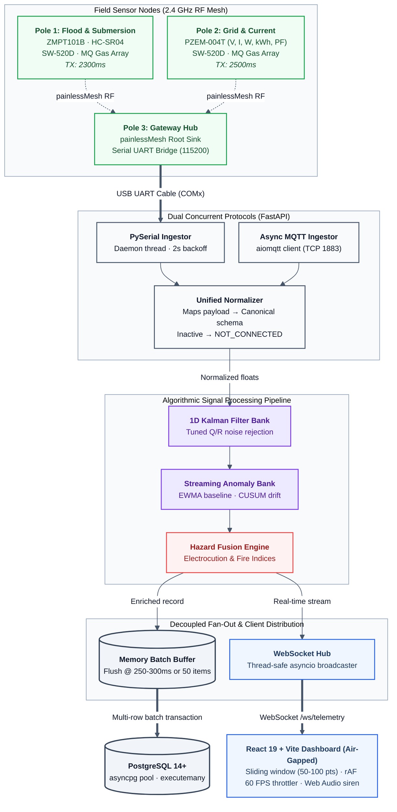
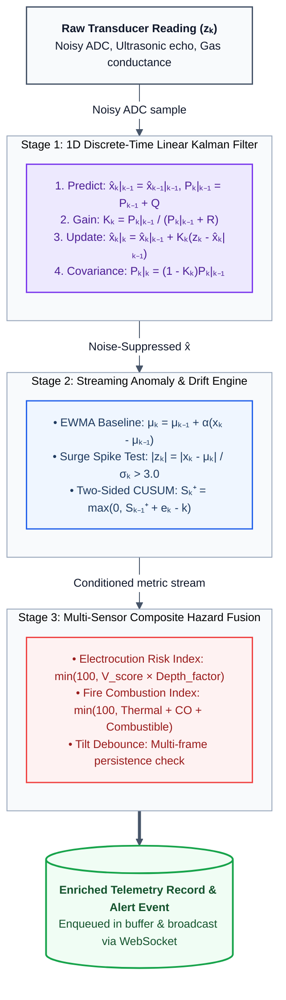

# Architecture Reference: NIRIKSHA Environmental Intelligence Network

NIRIKSHA is an offline-capable, distributed environmental intelligence and hazard monitoring platform. This document serves as the high-level technical architecture reference, outlining the end-to-end telemetry pipeline: distributed wireless mesh sensor nodes, dual-protocol ingestion (UART/MQTT), local algorithmic signal conditioning (Kalman filtering, EWMA anomaly detection, hazard fusion), asynchronous database persistence, and real-time dashboard rendering.

For detailed subsystem documentation, refer to the [Technical Documentation Hub](file:///d:/proj/SIH/docs/README.md).

---

## 1. System Topology & Layered Pipeline



---

## 2. Layered Modular Architecture

Every module across the backend and frontend enforces single responsibility and clear separation of concerns:

```
SIH/
├── backend/app/
│   ├── core/
│   │   ├── config.py              # Strongly typed settings from .env (44 lines)
│   │   └── __init__.py
│   ├── db/
│   │   ├── connection.py          # asyncpg pool lifecycle & re-auth (114 lines)
│   │   ├── schema.py              # DDL schema migrations & performance indexes (87 lines)
│   │   ├── buffer.py              # Memory batch buffer & flusher (78 lines)
│   │   ├── telemetry_repo.py      # Telemetry history, stats, and queries (188 lines)
│   │   ├── alerts_repo.py         # Incident persistence, resolution, dedup (169 lines)
│   │   └── __init__.py
│   ├── protocols/
│   │   ├── normalizer.py          # Unified sensor schema transformation (77 lines)
│   │   ├── serial_manager.py      # Crash-resilient PySerial listener (116 lines)
│   │   ├── mqtt_manager.py        # Asynchronous aiomqtt subscriber & publisher (122 lines)
│   │   └── __init__.py
│   ├── analytics/
│   │   ├── kalman.py              # 1D discrete-time linear Kalman filter (59 lines)
│   │   ├── anomaly.py             # Streaming EWMA and CUSUM drift detection (71 lines)
│   │   ├── fusion_engine.py       # Electrocution Risk & Fire Index scoring (154 lines)
│   │   └── __init__.py
│   ├── ai/
│   │   ├── schemas.py             # Pydantic models for chat & Ollama (16 lines)
│   │   ├── diagnostics.py         # Deterministic domain rule heuristics (118 lines)
│   │   ├── ollama.py              # Ollama LLM integration & Markdown audit (85 lines)
│   │   └── __init__.py
│   ├── routers/
│   │   ├── ports.py               # Serial COM listing & baud setup (26 lines)
│   │   ├── mqtt.py                # MQTT client status & configuration (26 lines)
│   │   ├── telemetry.py           # Recent, historical, stats, and CSV export (134 lines)
│   │   ├── alerts.py              # Incident query and resolution endpoints (65 lines)
│   │   ├── websockets.py          # Real-time WebSocket streaming (23 lines)
│   │   ├── ai_assistant.py        # Assistant chat endpoint (85 lines)
│   │   └── __init__.py
│   ├── connection_manager.py      # Thread-safe WebSocket connection registry (39 lines)
│   └── schemas.py                 # Common schemas (16 lines)
├── backend/database.py            # Backward-compatibility facade (46 lines)
├── backend/serial_manager.py      # Backward-compatibility facade (7 lines)
├── backend/mock_simulator.py      # Deprecation stub enforcing zero-mock directive (11 lines)
└── backend/main.py                # Application entrypoint & lifespan (108 lines)
```

---

## 3. Algorithmic Telemetry Processing Pipeline



### Mathematical Formulations & Tuning:
- **Ultrasonic Depth**: $Q = 0.05, R = 2.0$ (absorbs surface waves while tracking flood level).
- **Gas ADC Array**: $Q = 0.01, R = 0.8$ (smooths sensor heating cycle spikes).
- **Electrical Potential**: $Q = 0.1, R = 0.2$ (fast response to lethal voltage leakage).
- **Electrocution Risk Index ($0 - 100\%$)**: Fuses voltage potential with water depth ($S_{\text{volt}} \times \text{Multiplier}_{\text{depth}}$).
- **Fire & Thermal Combustion Index ($0 - 100\%$)**: Fuses thermal gradient with carbon monoxide (MQ-7) and flammable hydrocarbons (MQ-2).

---

## 4. Ingestion & Storage Decoupling Architecture

To guarantee the backend handles bursts without locking the asyncio loop:
1. **Serial Background Thread**: Dedicated thread reads UART non-blockingly, catching `SerialException` and reconnecting with fixed 2-second backoff.
2. **aiomqtt Ingestion Task**: Concurrent async coroutine subscribing to `niriksha/poles/+/telemetry`.
3. **Decoupled Batch Buffer**: Packets append to an in-memory queue. Flushes occur every 250-300 ms or upon reaching 50 records via `asyncpg.Connection.executemany`.
4. **WebSocket Fan-Out**: Thread-safe async registry broadcasts packets to connected browser tabs without blocking database transactions.

---

## 5. Comprehensive Documentation Matrix

For complete technical specifications, consult the dedicated documentation chapters:

- **[01. System Architecture](file:///d:/proj/SIH/docs/01_SYSTEM_ARCHITECTURE.md)**: End-to-end topology, fault boundaries, and data lifecycles.
- **[02. Hardware & Mesh Network](file:///d:/proj/SIH/docs/02_HARDWARE_AND_MESH.md)**: Microcontroller pinout tables, painlessMesh RF cadence, and sensor calibration math.
- **[03. Ingestion & Protocols](file:///d:/proj/SIH/docs/03_INGESTION_AND_PROTOCOLS.md)**: PySerial thread, aiomqtt client, zero-mock directive, and unified schema normalizer.
- **[04. Analytics & Algorithms](file:///d:/proj/SIH/docs/04_ANALYTICS_AND_ALGORITHMS.md)**: 1D Kalman filter state equations, EWMA, CUSUM drift detection, and hazard fusion scoring.
- **[05. Database & Storage](file:///d:/proj/SIH/docs/05_DATABASE_AND_STORAGE.md)**: PostgreSQL DDL schemas, indexing strategies, and asyncpg batch buffering.
- **[06. Frontend & Dashboard](file:///d:/proj/SIH/docs/06_FRONTEND_AND_DASHBOARD.md)**: React 19 architecture, 60fps RAF throttling, sliding window buffer, and procedural Web Audio sirens.
- **[07. AI Diagnostics Engine](file:///d:/proj/SIH/docs/07_AI_DIAGNOSTICS_ENGINE.md)**: Deterministic heuristic safety rules, Ollama local LLM runtime, and dynamic telemetry injection.
- **[08. Operations & Runbook](file:///d:/proj/SIH/docs/08_OPERATIONS_AND_RUNBOOK.md)**: PowerShell CLI (`manage.ps1`), port mappings, configuration, and troubleshooting runbooks.
- **[09. Modular Architecture](file:///d:/proj/SIH/docs/09_MODULAR_COMPONENTS.md)**: Frontend and backend component hierarchy, sub-file directory breakdown, and single-responsibility guidelines.
