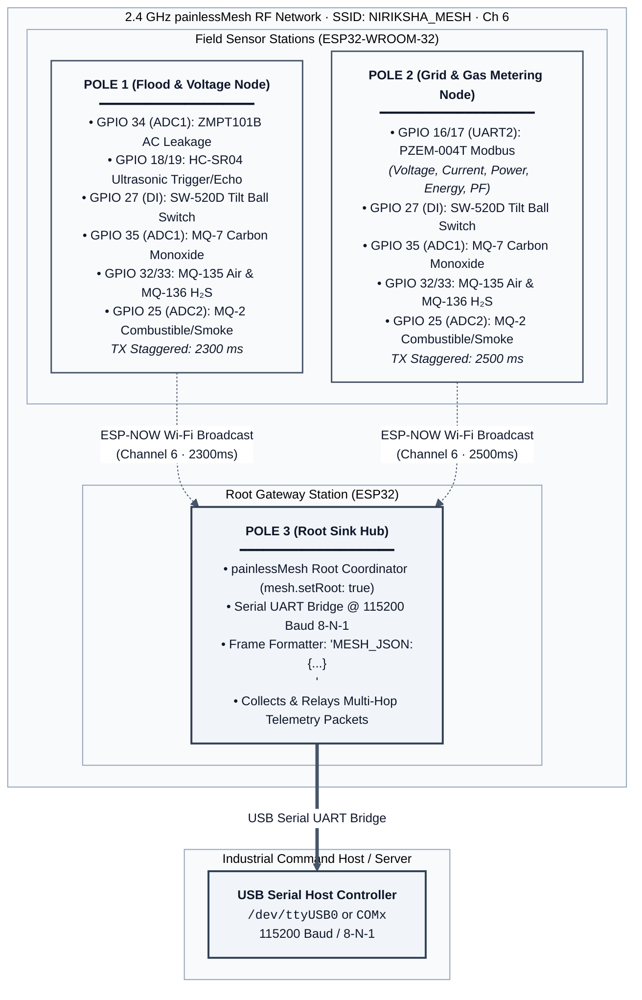
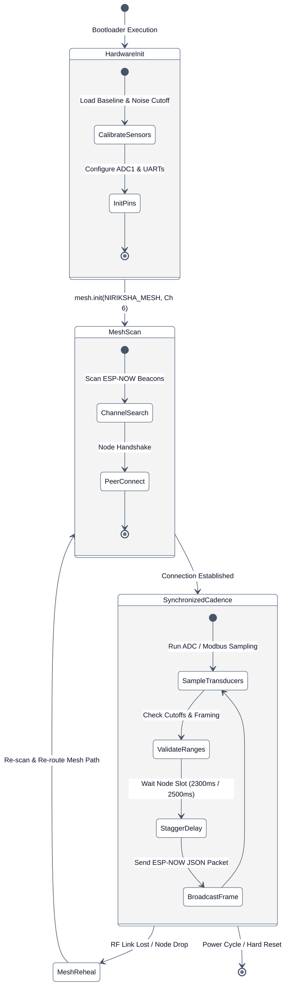

# 02. Hardware Architecture & Mesh Network

This document specifies the embedded hardware instrumentation, microcontroller pin configurations, 2.4GHz wireless mesh protocol, and mathematical sensor calibration procedures across all NIRIKSHA street poles.

---

## 1. Physical Node Roles & Topology

NIRIKSHA deploys three distinct physical nodes across an urban monitoring sector. Each node is powered by an Espressif ESP32-WROOM-32 microcontroller communicating over an ad-hoc 2.4 GHz radio mesh using `painlessMesh` (built on ESP-NOW Wi-Fi broadcast frames).





---

## 2. Staggered Transmission Cadence

In peer-to-peer radio meshes without a central scheduling coordinator, multiple nodes transmitting on the same 2.4 GHz channel simultaneously cause frame collisions, receiver packet drops, and radio retransmission storms.

To guarantee zero collisions across continuous operation:
- **Pole 1 Interval**: `2300 ms`
- **Pole 2 Interval**: `2500 ms`
- **Cadence Drift**: Because $2300$ and $2500$ share a greatest common divisor of $100$, the phase alignment shifts continuously. Collision windows overlap only once every 57.5 seconds, during which painlessMesh's built-in CSMA/CA (Carrier Sense Multiple Access with Collision Avoidance) backoff handles the minor contention window.

### painlessMesh Radio Configuration
```cpp
#define MESH_PREFIX   "NIRIKSHA_MESH"
#define MESH_PASSWORD "nirikshaSecure2026"
#define MESH_PORT     5555
#define MESH_CHANNEL  6  // Fixed 2.4 GHz channel to minimize urban Wi-Fi hopping
```

---

## 3. Sensor Suite & Calibration Principles

### 3.1 ZMPT101B Active AC Voltage Leakage Probe (Pole 1)
- **Physical Application**: Installed at the base of Pole 1 with exposed insulated stainless steel probes submerged in the municipal street drain or gutter. Detects hazardous utility leakage into flood water.
- **Microcontroller Pin**: `GPIO 34` (ADC1 Channel 6).
- **Sampling Window**: Alternating current operates at 50 Hz ($T = 20\text{ ms}$). To accurately capture peak voltage regardless of phase alignment, the firmware samples continuously for 40 ms (two full sinusoidal cycles).
- **Firmware Calibration Logic**:
  ```cpp
  const int NOISE_CUTOFF = 1100;
  float VOLTAGE_FACTOR = 0.1394;

  float readACVoltage() {
    uint32_t start_time = millis();
    int min_val = 4095;
    int max_val = 0;

    while (millis() - start_time < 40) {
      int sample = analogRead(ZMPT_PIN);
      if (sample < min_val) min_val = sample;
      if (sample > max_val) max_val = sample;
    }

    int p2p = max_val - min_val;
    if (p2p < NOISE_CUTOFF) return 0.0; // Cut off ambient electronic background noise

    float v_rms = (p2p - NOISE_CUTOFF) * VOLTAGE_FACTOR;
    return v_rms;
  }
  ```

### 3.2 PZEM-004T V3.0 Industrial Power Meter (Pole 2)
- **Physical Application**: Connected to the primary municipal street-lighting feeder cable on Pole 2. Provides utility-grade metering of electrical load, voltage stability, and line health.
- **Interface**: Hardware UART2 (`RX2 = GPIO 16`, `TX2 = GPIO 17`) communicating via Modbus-RTU at 9600 baud.
- **Acquired Parameters**:
  - Voltage: $80.0\text{ to }260.0\text{ V RMS}$ (Resolution: $0.1\text{ V}$)
  - Current: $0.000\text{ to }100.0\text{ A}$ (Resolution: $0.001\text{ A}$)
  - Active Power: $0.0\text{ to }23000.0\text{ W}$ (Resolution: $0.1\text{ W}$)
  - Energy: $0.0\text{ to }9999.99\text{ kWh}$ (Resolution: $1\text{ Wh}$)
  - Grid Frequency: $45.0\text{ to }65.0\text{ Hz}$ (Resolution: $0.1\text{ Hz}$)
  - Power Factor: $0.00\text{ to }1.00$

### 3.3 HC-SR04 Ultrasonic Flood Depth Sensor (Pole 1)
- **Physical Application**: Downward-facing transceiver mounted at a fixed structural height above the street pavement.
- **Microcontroller Pins**: `TRIG_PIN = GPIO 18`, `ECHO_PIN = GPIO 19`.
- **Calculation Formula**:
  $$\text{distance}_{\text{cm}} = \frac{t_{\text{echo\_us}} \times 0.0343}{2}$$
  $$\text{water\_depth}_{\text{cm}} = H_{\text{pole\_mount}} - \text{distance}_{\text{cm}}$$
- **Rejection Logic**: Ultrasonic readings under 2 cm or exceeding the known physical pole height ($H_{\text{pole\_mount}}$) are flagged as multipath reflection anomalies and ignored.

### 3.4 SW-520D Gold-Plated Tilt Sensor (All Poles)
- **Physical Application**: Detects structural collapse, storm leaning, or severe vehicular collisions with the pole structure.
- **Microcontroller Pin**: `GPIO 27` configured with internal pullup resistor (`INPUT_PULLUP`).
- **Mechanical Operation**: A metallic ball bridges two internal conductive pins when upright ($0^\circ \text{ to } 45^\circ$). Displacements exceeding $45^\circ$ cause the circuit to break open:
  - $\text{State} = \text{HIGH} \implies \text{is\_upright} = \text{true}$
  - $\text{State} = \text{LOW} \implies \text{is\_upright} = \text{false}$
- **Host Debouncing**: Because physical vibrations from heavy passing trucks can briefly bounce the mechanical ball, the backend processing pipeline enforces a 2-sample consecutive debounce confirmation window before triggering a structural collapse alarm.

### 3.5 Metal Oxide Gas Array (MQ-7, MQ-135, MQ-136, MQ-2)
- **Gas Instrumentation**:
  - **MQ-7**: Carbon Monoxide (CO) - tracks smoldering electrical insulation and vehicular exhaust.
  - **MQ-135**: Air Quality (Ammonia, NOx, Benzene) - monitors municipal air degradation.
  - **MQ-136**: Hydrogen Sulfide ($H_2S$) - detects lethal sewer gas escapes from storm drains.
  - **MQ-2**: Combustible Gases & Smoke (LPG, Propane, Methane) - detects explosive pipe leaks.
- **Analog-to-PPM Normalization**: The raw 12-bit ADC reading ($0\text{ to }4095$) from the ESP32 is normalized into approximate PPM curves:
  $$\text{ppm}_{\text{MQ7}} = \text{raw}_{\text{ADC}} \times \left(\frac{100.0}{4095.0}\right)$$
  $$\text{ppm}_{\text{MQ135}} = \text{raw}_{\text{ADC}} \times \left(\frac{300.0}{4095.0}\right)$$

---

## 4. Root Hub Packet Framing & Serialization

When the Pole 3 Root Gateway node receives a mesh packet from any node, it validates the JSON payload, formats a single-line ASCII frame prefixed with `MESH_JSON:`, and transmits it out of Hardware Serial 0 (`GPIO 1`) at 115200 baud.

### Example Raw UART Line Broadcast:
```text
MESH_JSON:{"pole_id":1,"water_depth":24.5,"is_upright":true,"voltage":0.0,"mq7":12.4,"mq135":35.2,"mq136":4.1,"mq2":18.0}
```

```text
MESH_JSON:{"pole_id":2,"voltage":231.4,"current":4.21,"power":965.8,"energy":14.28,"frequency":50.0,"pf":0.98,"is_upright":true,"mq7":8.2,"mq135":22.1,"mq136":2.0,"mq2":11.5}
```

### Critical Architecture Note on Firmware Directory
The C++ sketches located inside `firmware/` (`pole1_sensor_node`, `pole2_sensor_node`, and `pole3_gateway_hub`) represent verified, flashed embedded images. They are **read-only** reference code and must never be modified by automated backend or frontend refactoring processes. For hardware wiring diagrams and flashing guidelines, see [Firmware Documentation](file:///d:/proj/SIH/firmware/README.md).
