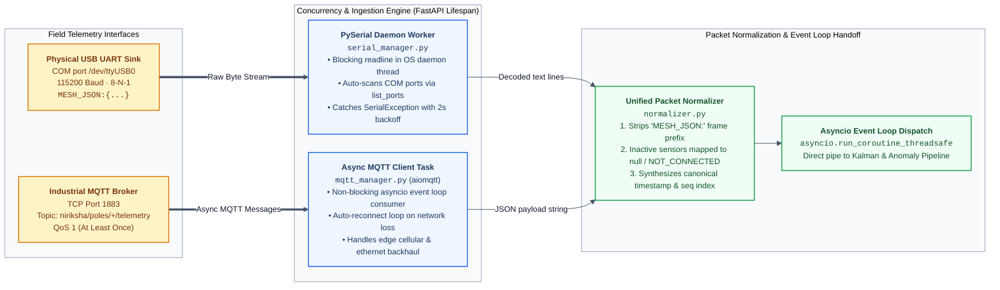
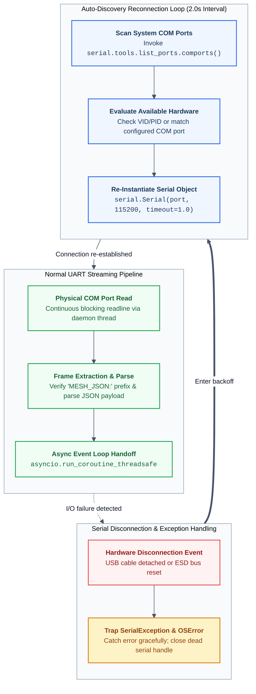

# 03. Telemetry Ingestion & Dual Protocols

NIRIKSHA ingests live field telemetry through two concurrent real-world communication protocols: **Physical Serial UART (`pyserial`)** and an **Industrial MQTT Broker (`aiomqtt`)**. This document details the worker threading model, fault recovery loops, packet normalization, and the strict zero-simulation directive.

---

## 1. Dual Ingestion Architecture

The ingestion layer runs within the FastAPI process lifespan, decoupling physical hardware I/O from the asynchronous event loop and database write buffer.





---

## 2. Physical Serial UART Worker (`serial_manager.py`)

### 2.1 The Threading Challenge in Asynchronous Servers
In Python's `asyncio`, executing blocking file or device I/O (such as reading from an operating system COM port via `serial.Serial.readline()`) directly in an `async` function freezes the entire event loop. When the loop freezes, WebSocket connections drop, REST endpoints time out, and database flushes stall.

To guarantee zero latency on the event loop:
1. `SerialManager` spawns a dedicated OS-level daemon thread (`threading.Thread(target=self._worker_loop, daemon=True)`).
2. The worker thread loops on `ser.readline()`, which yields to other OS threads while waiting for UART characters.
3. Upon receiving a valid frame, the thread safely dispatches the packet into the asyncio event loop using `asyncio.run_coroutine_threadsafe(self._process_packet(line), self.loop)`.

### 2.2 Serial Fault Tolerance & Reconnection Loop
USB cables in laboratory or field environments are frequently subject to physical vibration, electrostatic discharge (ESD), or accidental disconnection. 

The worker implements defensive exception handling:
```python
while self._is_running:
    try:
        if not self._serial or not self._serial.is_open:
            port = self._discover_or_configured_port()
            if not port:
                time.sleep(2.0)
                continue
            self._serial = serial.Serial(port=port, baudrate=self.baudrate, timeout=1.0)
            logger.info(f"Connected to physical Serial COM port: {port}")

        line = self._serial.readline().decode('utf-8', errors='ignore').strip()
        if not line:
            continue

        if "MESH_JSON:" in line:
            self._dispatch_to_async(line)

    except (serial.SerialException, OSError) as e:
        logger.warning(f"Serial communication fault ({e}). Reconnecting in 2.0s...")
        if self._serial:
            try:
                self._serial.close()
            except Exception:
                pass
            self._serial = None
        time.sleep(2.0)
```

**Key Operational Properties:**
- A disconnected USB cable will **never crash** the FastAPI backend.
- Reconnection attempts occur every 2 seconds without operator intervention.
- The manager dynamically scans the operating system registry/device tree using `serial.tools.list_ports.comports()`, allowing the gateway to automatically bind even if the OS assigns a new COM port index upon re-insertion.

---

## 3. Industrial MQTT Ingestion (`mqtt_manager.py`)

In distributed municipal topologies where poles are kilometers away from the central monitoring computer, serial cables cannot bridge the physical distance. In this scenario, Pole 3 or intermediate cellular RTUs publish to an MQTT broker.

### 3.1 Broker Specification
- **Library**: `aiomqtt` (pure asynchronous MQTT client built on `paho-mqtt` and `asyncio`).
- **Default Port**: `1883` (configurable in `.env`).
- **Topic Subscription Pattern**:
  - `niriksha/poles/+/telemetry`: Individual pole telemetry published by remote edge gateways.
  - `telemetry/#`: Legacy broker topic fallback.

### 3.2 Resilience & QoS
- Uses **QoS 1 (At Least Once)** delivery to ensure packets are not lost during momentary cellular fade.
- The MQTT client runs an internal exponential backoff reconnect loop:
  $$\tau_{\text{retry}} = \min(30.0, 1.0 \times 1.5^{\text{attempt}})$$

---

## 4. Strict Production Directives: Zero Synthetic Simulation

In production environments, **all synthetic random-walk generators and mock simulation files (`mock_simulator.py`) are strictly prohibited**.

### Rationale:
1. **False Sense of Operational Health**: Random number generators mask hardware faults, cold solder joints, ADC drift, and transmission collisions.
2. **Safety Criticality**: In municipal flood and electrocution monitoring, synthetic data could overwrite genuine hazard breaches or generate simulated false alarms that erode operator trust.
3. **Hardware Truth**: If no physical microcontroller or MQTT broker is publishing, the platform must truthfully display an **OFFLINE / DISCONNECTED** status.

The legacy file `backend/mock_simulator.py` is permanently deprecated and serves as an explicit warning stub:
```python
raise RuntimeError(
    "MOCK SIMULATION VIOLATION: Synthetic mock ingestion is strictly prohibited in production. "
    "Telemetry must arrive via physical Serial COM or Industrial MQTT broker."
)
```

---

## 5. Unified Packet Normalization (`normalizer.py`)

Because different poles carry different hardware sensors (e.g., Pole 1 carries ultrasonic depth and ZMPT101B voltage probes, whereas Pole 2 carries PZEM-004T grid power metering), incoming raw packets possess non-uniform JSON keys.

The `normalize_mesh_packet()` function transforms all incoming payloads into a canonical, uniform sensor schema.

### 5.1 Inactive Sensor Contract: `NOT_CONNECTED` & `null`
A critical failure mode in generic IoT dashboards is displaying `0.0` or `0` for sensors that are not physically present on a given node. 
- A display of `0.0V` implies *safe grounded zero potential*.
- A display of `0.0 cm` implies *no flood water*.
- If a pole does **not carry** that sensor, displaying `0` is dangerously misleading.

**The Canonical Rule:**
If a sensor reading is missing or physically absent from a pole's payload:
- Its numerical value in the root dictionary MUST be explicitly set to `None` (`null` in JSON).
- Its entry in the nested `sensors` dictionary MUST have its status set to `"NOT_CONNECTED"`.

### 5.2 Canonical Schema Definition

```python
{
    "seq": 1042,
    "timestamp": 1726815492.381,
    "pole_id": 1,
    "mesh_node_id": 348192847,
    "temperature": 28.4,
    "humidity": 68.2,
    "water_depth": 24.5,
    "is_upright": True,
    "voltage": 0.0,
    "current_ma": None,      # Not carried on Pole 1
    "power": None,           # Not carried on Pole 1
    "energy": None,          # Not carried on Pole 1
    "frequency": None,       # Not carried on Pole 1
    "pf": None,              # Not carried on Pole 1
    "mq7": 12.4,
    "mq135": 35.2,
    "mq136": 4.1,
    "mq2": 18.0,
    "sensors": {
        "temperature": {"val": 28.4, "status": "CONNECTED", "unit": "°C"},
        "water_depth": {"val": 24.5, "status": "CONNECTED", "unit": "cm"},
        "voltage":     {"val": 0.0,  "status": "CONNECTED", "unit": "V"},
        "power":       {"val": None, "status": "NOT_CONNECTED", "unit": "W"},
        "current":     {"val": None, "status": "NOT_CONNECTED", "unit": "A"}
    },
    "status": "NORMAL",
    "source": "SERIAL:COM3"
}
```

The React frontend inspects `sensors[metric].status`. If it is `"NOT_CONNECTED"`, the metric card renders a clear slate-colored badge: `"Not Connected"`.
