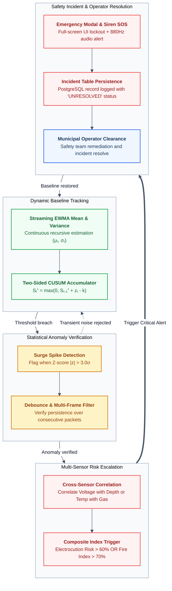

# 04. Algorithmic Analytics & Hazard Signal Processing

Raw transducer data from field-deployed IoT sensors is inherently noisy: analog ADC lines experience electromagnetic interference, ultrasonic acoustic pulses bounce off surface ripples, and gas sensors undergo heating-cycle fluctuations. Relying on raw, unconditioned sensor readings leads to rampant false alarms or missed catastrophic failures.

NIRIKSHA routes all normalized telemetry through an in-memory algorithmic processing pipeline before database storage or client broadcasting:
1. **1D Discrete-Time Linear Kalman Filtering** for noise and jitter rejection.
2. **Streaming Statistical Anomaly Detection** (EWMA Dynamic Baselines & CUSUM Drift Tracking).
3. **Multi-Sensor Composite Hazard Fusion** (Electrocution Risk Index, Fire & Combustion Index, and Tilt Debounce).

---

## 1. Algorithmic Pipeline Architecture

```mermaid
%%{init: {
  "theme": "base",
  "themeVariables": {
    "fontFamily": "Inter, Segoe UI, -apple-system, BlinkMacSystemFont, Roboto, sans-serif",
    "fontSize": "13px",
    "primaryColor": "#ffffff",
    "primaryBorderColor": "#64748b",
    "primaryTextColor": "#0f172a",
    "lineColor": "#475569",
    "clusterBkg": "#f8fafc",
    "clusterBorder": "#94a3b8"
  },
  "flowchart": { "curve": "basis", "htmlLabels": true, "nodeSpacing": 25, "rankSpacing": 40 }
} }%%
flowchart LR
    RAW["<b>Raw Normalized Packet</b><br/><code>normalizer.py</code><br/>Noisy ADC, Ultrasonic, Gas"]

    subgraph STAGE1["Stage 1: 1D Kalman Filter Bank (kalman.py)"]
        direction TB
        K1["<b>Recursive State Estimator</b><br/>• Time Update: x̂⁻ = x̂, P⁻ = P + Q<br/>• Measurement Update: K = P⁻ / (P⁻ + R)<br/>• x̂ = x̂⁻ + K(z - x̂⁻), P = (1 - K)P⁻<br/>• Channels: Depth, Gas ADCs, ZMPT101B"]
    end

    subgraph STAGE2["Stage 2: Streaming Anomaly Bank (anomaly.py)"]
        direction TB
        A1["<b>Statistical Drift &amp; Spike Flagging</b><br/>• EWMA Mean: μₜ = α xₜ + (1 - α) μₜ₋₁<br/>• Streaming Variance (Welford adaptation)<br/>• Dynamic Z-Score Spike: |z| = |x - μ| / σ &gt; 3.0<br/>• Two-Sided CUSUM: Slow toxic drift detection"]
    end

    subgraph STAGE3["Stage 3: Hazard Fusion Engine (fusion_engine.py)"]
        direction TB
        F1["<b>Multi-Sensor Cross Fusion</b><br/>• <b>Electrocution Risk Index:</b><br/>  f(ZMPT AC Leakage, HC-SR04 Depth)<br/>• <b>Fire &amp; Combustion Index:</b><br/>  f(Thermal Rate of Rise, MQ-7, MQ-2)<br/>• <b>Tilt Debounce:</b> Multi-frame persistence"]
    end

    ENRICHED[("<b>Enriched Record</b><br/>Filtered values + Risk Indices<br/>→ Buffer &amp; WebSockets")]

    RAW -->|"Raw Floats"| STAGE1
    STAGE1 -->|"Noise-Suppressed Stream"| STAGE2
    STAGE2 -->|"Z-Scores &amp; Drift Metric"| STAGE3
    STAGE3 -->|"Composite Alerts &amp; Telemetry"| ENRICHED

    classDef default fill:#ffffff,stroke:#64748b,stroke-width:1px,color:#0f172a;
    classDef nodeRaw fill:#f8fafc,stroke:#475569,stroke-width:1.5px,color:#0f172a;
    classDef nodeKalman fill:#ede9fe,stroke:#7c3aed,stroke-width:1.5px,color:#4c1d95;
    classDef nodeAnomaly fill:#eff6ff,stroke:#2563eb,stroke-width:1.5px,color:#1e3a5f;
    classDef nodeHazard fill:#fef2f2,stroke:#ef4444,stroke-width:1.5px,color:#991b1b;
    classDef nodeEnriched fill:#f0fdf4,stroke:#16a34a,stroke-width:2px,color:#14532d;

    class RAW nodeRaw;
    class K1 nodeKalman;
    class A1 nodeAnomaly;
    class F1 nodeHazard;
    class ENRICHED nodeEnriched;
```

---

## 2. 1D Discrete-Time Linear Kalman Filter (`kalman.py`)

The 1D Kalman filter operates as an optimal recursive data estimator, minimizing the mean squared error between noisy ADC measurements and the underlying physical process state without buffering historical vectors.

### 2.1 State-Space Equations
For each discrete time step $k$:

1. **State Extrapolation (Prediction)**:
   $$\hat{x}_{k|k-1} = \hat{x}_{k-1|k-1}$$
   The expected state equals the previous estimated state (random-walk assumption).

2. **Covariance Extrapolation (Prediction Error)**:
   $$P_{k|k-1} = P_{k-1|k-1} + Q$$
   Where $Q$ is the process noise covariance (how rapidly the physical environment can genuinely change).

3. **Kalman Gain Computation**:
   $$K_k = \frac{P_{k|k-1}}{P_{k|k-1} + R}$$
   Where $R$ is the measurement noise covariance (sensor instrument error / ADC jitter).

4. **State Estimate Update**:
   $$\hat{x}_{k|k} = \hat{x}_{k|k-1} + K_k \cdot (z_k - \hat{x}_{k|k-1})$$
   Where $z_k$ is the raw sensor reading. $K_k$ dynamically weights between the prediction and the new measurement:
   - When sensor noise $R$ is large, $K_k \to 0$ (filter favors historical inertia).
   - When estimation error $P$ is large, $K_k \to 1$ (filter snaps rapidly to new measurements).

5. **Covariance Update**:
   $$P_{k|k} = (1 - K_k) \cdot P_{k|k-1}$$

### 2.2 Empirical Covariance Tuning Matrix

The filter parameters are calibrated in `PoleKalmanBank` according to physical transducer dynamics:

| Sensor Type | Process Variance ($Q$) | Measurement Variance ($R$) | Physical Justification |
| :--- | :--- | :--- | :--- |
| **Ultrasonic Flood Depth (`water_depth`)** | $0.05$ | $2.00$ | Surface ripples, wind turbulence, and acoustic echo jitter produce high measurement variance ($R=2.0$). Actual floodwater rises smoothly ($Q=0.05$). |
| **Metal Oxide Gas Array (`mq7`, `mq135`, etc.)** | $0.01$ | $0.80$ | Gas sensor heaters cycle and cause baseline thermal ADC wobble. Chemical dispersion in air is relatively gradual. |
| **Electrical Potential (`voltage`, `current_ma`)** | $0.10$ | $0.20$ | Electrical line faults happen instantaneously ($Q=0.10$). The filter must respond in milliseconds to lethal potential without lagging behind reality. |

---

## 3. Streaming Statistical Anomaly Detection (`anomaly.py`)

Static alert thresholds (e.g. `water_depth > 100 cm`) fail to detect early-stage anomalous behavior, such as a localized water accumulation rising abnormally fast or a subtle chemical leak that has not yet crossed a catastrophic boundary.

NIRIKSHA executes two statistical detection algorithms on every telemetry channel:

### 3.1 Streaming Exponentially Weighted Moving Average (EWMA)
To avoid storing large time-series arrays in RAM, EWMA dynamically updates running mean $\mu$ and standard deviation $\sigma$ in $O(1)$ constant time using an incremental Welford adaptation:

$$\mu_k = \mu_{k-1} + \alpha \cdot (x_k - \mu_{k-1})$$
$$\sigma^2_k = (1 - \alpha) \cdot \left(\sigma^2_{k-1} + \alpha \cdot (x_k - \mu_{k-1})^2\right)$$

- **Smoothing Factor**: $\alpha = 0.10$
- **Dynamic Z-Score Surge Trigger**:
  $$z_k = \frac{x_k - \mu_k}{\sigma_k}$$
  If $|z_k| > 3.0$, the measurement deviates by more than 3 standard deviations from its moving baseline, flagging an instant **SURGE_ANOMALY**.

### 3.2 Two-Sided Cumulative Sum (CUSUM) Drift Detector
CUSUM is an optimal quality control chart for detecting subtle, insidious shifts in the mean level of a process that are too small to trip a single-sample $3\sigma$ threshold.

$$\text{Error}: e_k = x_k - \mu_{\text{expected}}$$
$$\text{Positive Accumulator}: S_k^+ = \max(0, S_{k-1}^+ + e_k - k_{\text{slack}})$$
$$\text{Negative Accumulator}: S_k^- = \max(0, S_{k-1}^- - e_k - k_{\text{slack}})$$

- **Slack Parameter ($k_{\text{slack}}$)**: Set to $0.5$ (permits normal minor fluctuations).
- **Decision Threshold ($h$)**: Set to $4.0$.
- **Detection Behavior**:
  - If $S_k^+ > 4.0$: Flags `UPWARD_DRIFT` (e.g. slow, persistent gutter blockage or smoldering wire insulation before open fire).
  - If $S_k^- > 4.0$: Flags `DOWNWARD_DRIFT` (e.g. degrading sensor battery voltage or failing sensor element).
  - Upon tripping, the accumulator resets to zero.

---

## 4. Multi-Sensor Composite Hazard Fusion (`fusion_engine.py`)

Disasters in urban infrastructure are rarely isolated single-sensor phenomena. Catastrophic municipal accidents occur when multiple environmental risks converge.

### 4.1 Electrocution Risk Index ($0.0 \text{ to } 100.0\%$)
A small voltage leakage into dry air is harmless; the same voltage leakage into standing flood water creates a lethal electric field that can paralyze pedestrians and emergency workers.

The fusion engine calculates:
$$S_{\text{volt}} = \min\left(100.0, \frac{V_{\text{measured}}}{5.0} \times 70.0\right)$$
$$\text{Multiplier}_{\text{depth}} = \begin{cases} 1.0 & \text{if } D_{\text{water}} \le 0 \\ \min\left(1.5, 1.0 + \frac{D_{\text{water}}}{200.0}\right) & \text{if } D_{\text{water}} > 0 \end{cases}$$
$$\text{Risk}_{\text{electrocution}} = \min(100.0, S_{\text{volt}} \times \text{Multiplier}_{\text{depth}})$$

- **Critical Threshold**: If $\text{Risk}_{\text{electrocution}} \ge 70.0\%$ (or raw $V > 5.0\text{V}$):
  - Raises a `critical` severity `voltage_surge` incident.
  - Automatically engages the browser's full-screen emergency modal and triggers the 880 Hz acoustic evacuation siren.

### 4.2 Fire & Thermal Combustion Index ($0.0 \text{ to } 100.0\%$)
During summer heatwaves, ambient air temperature can exceed $45^\circ\text{C}$ without any actual fire. Relying solely on a temperature sensor causes rampant false alarms. Conversely, an electrical fire inside a junction box produces toxic smoke and carbon monoxide before thermal heat radiates outward.

The fusion engine cross-verifies heat with chemical signatures:
$$S_{\text{thermal}} = \begin{cases} 0 & \text{if } T \le 35.0^\circ\text{C} \\ \min\left(50.0, \frac{T - 35.0}{25.0} \times 50.0\right) & \text{if } T > 35.0^\circ\text{C} \end{cases}$$
$$S_{\text{CO}} = \begin{cases} 0 & \text{if } \text{PPM}_{\text{MQ7}} \le 20.0 \\ \min\left(35.0, \frac{\text{PPM}_{\text{MQ7}} - 20.0}{30.0} \times 35.0\right) & \text{if } \text{PPM}_{\text{MQ7}} > 20.0 \end{cases}$$
$$S_{\text{combustible}} = \begin{cases} 0 & \text{if } \text{PPM}_{\text{MQ2}} \le 30.0 \\ \min\left(25.0, \frac{\text{PPM}_{\text{MQ2}} - 30.0}{40.0} \times 25.0\right) & \text{if } \text{PPM}_{\text{MQ2}} > 30.0 \end{cases}$$
$$\text{Index}_{\text{fire}} = \min(100.0, S_{\text{thermal}} + S_{\text{CO}} + S_{\text{combustible}})$$

- **Critical Outbreak**: If $\text{Index}_{\text{fire}} \ge 75.0\%$ or temperature exceeds $60.0^\circ\text{C}$, the engine dispatches a high-priority `fire_emergency` alert.

### 4.3 Structural Tilt Debounce Confirmation
The SW-520D mechanical tilt switch can briefly bounce when a heavy truck drives over an adjacent pothole.
- The engine maintains an internal `_tilt_counters[pole_id]`.
- When `is_upright == False`, the counter increments.
- A critical `tilt_collapse` alert is issued **only after 2 consecutive non-upright packets** ($> 4.6\text{ seconds}$ sustained displacement).
- When the pole returns upright, the counter immediately resets to zero.
