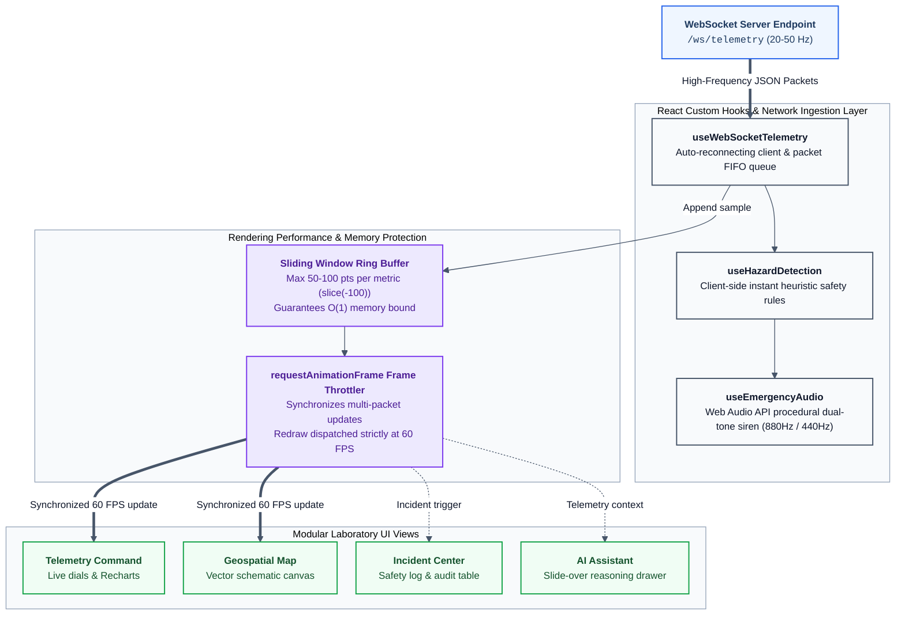
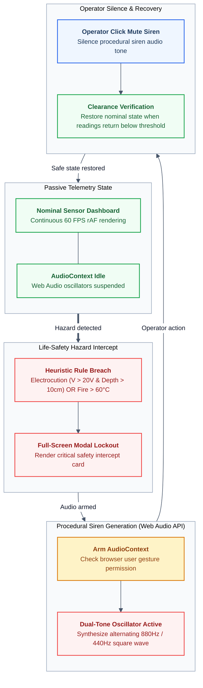

# 06. Frontend Architecture & Laboratory Dashboard

The NIRIKSHA frontend is built with **React 19**, **Vite**, and **TypeScript**. It is engineered to meet strict mission-critical industrial standards: continuous 24/7 uptime without memory leaks, strict offline air-gap compliance, and a laboratory-grade, high-contrast light aesthetic.

---

## 1. Frontend Rendering & State Flow





---

## 2. Laboratory-Grade Aesthetic & Styling Directives

Rather than adopting generic dark mode templates, NIRIKSHA adheres to an **air-gapped industrial laboratory aesthetic**:
- **Background**: Neutral light slate canvas (`bg-slate-50`).
- **Containers & Cards**: Clean solid white cards (`bg-white border border-slate-200 shadow-sm rounded-lg`).
- **Typography**: High-legibility slate hierarchy (`text-slate-900` for primary values, `text-slate-700` for metric labels, `text-slate-500` for units and timestamps).
- **Primary Cobalt Accent**: `#2563eb` (Tailwind `blue-600`) for navigation highlights, active tabs, and primary controls.
- **Chart Palette**: High-contrast cobalt blue (`#2563eb`) for data paths, soft emerald (`#16a34a`) for nominal boundaries, and crimson (`#dc2626`) for critical danger breaches.

### Strict Air-Gap Isolation
1. **Offline Typography**: Fonts are imported statically via `@fontsource/inter` in `frontend/src/main.tsx`. External Google Fonts links are strictly excluded from `index.html`.
2. **Offline Iconography**: All icons are imported directly from the locally bundled `lucide-react` package.
3. **No External Scripts**: No third-party CDN bundles or tracking libraries exist in the distribution bundle.

---

## 3. Client Performance & Memory Protection

### 3.1 Sliding Window State Management
A client left running continuously in an operations center must never crash due to memory exhaustion. If a dashboard appends every incoming packet to an unbounded array:
$$10\text{ packets/sec} \times 3600\text{ sec/hr} \times 24\text{ hr} = 864,000\text{ objects in memory}$$
This causes the browser tab's JavaScript heap to balloon past 2 GB, resulting in browser out-of-memory crashes.

NIRIKSHA strictly enforces a **sliding window buffer**:
```typescript
setTelemetryHistory(prev => {
  const updated = [...prev, newPacket];
  if (updated.length > 100) {
    return updated.slice(updated.length - 100);
  }
  return updated;
});
```
This guarantees constant space complexity $O(1)$ in RAM regardless of uptime duration.

### 3.2 `requestAnimationFrame` Render Throttling
When multiple nodes transmit asynchronously, WebSocket packets can arrive faster than the monitor's display refresh rate ($60\text{ Hz} \approx 16.6\text{ ms}$). Updating React state on every raw packet triggers multiple expensive React render passes per display frame, creating micro-stutters and SVG rendering lag.

By throttling updates through `requestAnimationFrame`:
1. Arriving WebSocket packets are appended to a lightweight reference queue (`useRef([])`).
2. The browser requests an animation frame.
3. When the frame executes, all accumulated packets are merged into state in a single atomic dispatch.
4. Canvas and SVG components re-render exactly once per screen refresh, guaranteeing a smooth 60 FPS user experience.

---

## 4. Procedural Web Audio Emergency Siren (`useEmergencyAudio.ts`)

Air-gapped operation requires that acoustic sirens operate reliably without relying on external `.mp3` or `.wav` media files, which could fail to load or get blocked by cross-origin policies.

NIRIKSHA synthesizes emergency sirens entirely in software using the browser's native **Web Audio API**:

```typescript
class EmergencyAudioSynthesizer {
  private ctx: AudioContext | null = null;
  private osc: OscillatorNode | null = null;
  private gain: GainNode | null = null;

  startSiren() {
    if (!this.ctx) this.ctx = new (window.AudioContext || (window as any).webkitAudioContext)();
    if (this.osc) return;

    this.osc = this.ctx.createOscillator();
    this.gain = this.ctx.createGain();

    this.osc.type = 'sawtooth';
    // Modulate pitch between 880Hz (A5) and 440Hz (A4)
    this.osc.frequency.setValueAtTime(880, this.ctx.currentTime);
    this.osc.frequency.exponentialRampToValueAtTime(440, this.ctx.currentTime + 0.5);

    this.gain.gain.setValueAtTime(0.15, this.ctx.currentTime); // Capped volume

    this.osc.connect(this.gain);
    this.gain.connect(this.ctx.destination);
    this.osc.start();
  }

  stopSiren() {
    if (this.osc) {
      this.osc.stop();
      this.osc.disconnect();
      this.osc = null;
    }
  }
}
```

Operators have instant access to an **Audio Arm / Mute** toggle in the top navigation bar, allowing them to silence the physical siren while reviewing incident logs.

---

## 5. Scalable Fleet Navigation (`PoleSelectDropdown.tsx`)

Many IoT dashboards hardcode tabs for a fixed number of nodes (e.g., `Pole 1`, `Pole 2`, `Pole 3`). When municipal deployments scale to 20 or 100 poles, fixed tab bars overflow and break the UI layout.

NIRIKSHA implements a scalable search dropdown:
- Supports arbitrary fleet sizes (Pole 1 through Pole $N$).
- Features instant real-time text filtering by Pole ID or location name.
- Displays quick-glance status chips (`ONLINE`, `OFFLINE`, `CRITICAL`) directly inside the dropdown menu items.
- Retains quick-access chips for the first 3 primary poles while providing the scalable selector for the entire network.

---

## 6. Modular Component Directory Reference

For the comprehensive catalog and responsibility breakdown of all 12 frontend subcomponent packages (`ai/`, `alerts/`, `charts/`, `compare/`, `dashboard/`, `fleet/`, `history/`, `map/`, `modals/`, `reports/`, `settings/`, `views/`), see [09. Modular Architecture & Component Reference](file:///d:/proj/SIH/docs/09_MODULAR_COMPONENTS.md).

