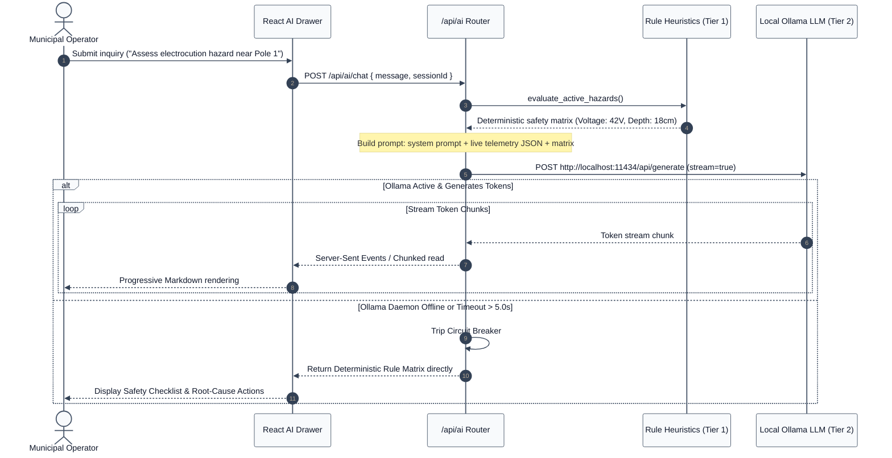

# 07. Offline AI Diagnostics & Inference Engine

NIRIKSHA incorporates an **offline machine reasoning engine** designed to assist municipal operators and emergency response crews during extreme weather, flooding, and utility failures. The AI assistant can diagnose complex multi-sensor hazards, explain root causes, and propose immediate mitigation steps without requiring an internet connection or external cloud LLM APIs.

---

## 1. Two-Tier Hybrid AI Architecture

The diagnostic engine is organized into a complementary two-tier pipeline: a deterministic rule engine operating at sub-millisecond speeds, backed by an on-premises local Large Language Model (LLM) managed via **Ollama**.

```mermaid
%%{init: {
  "theme": "base",
  "themeVariables": {
    "fontFamily": "Inter, Segoe UI, -apple-system, BlinkMacSystemFont, Roboto, sans-serif",
    "fontSize": "13px",
    "primaryColor": "#ffffff",
    "primaryBorderColor": "#64748b",
    "primaryTextColor": "#0f172a",
    "lineColor": "#475569",
    "clusterBkg": "#f8fafc",
    "clusterBorder": "#94a3b8"
  },
  "flowchart": { "curve": "basis", "htmlLabels": true, "nodeSpacing": 25, "rankSpacing": 40 }
} }%%
flowchart LR
    REQ["<b>Operator Diagnostic Query</b><br/>Chat drawer prompt or automated trigger"]

    subgraph AI_SUBSYSTEM["Offline AI Machine Reasoning Engine"]
        direction TB
        
        subgraph TIER1["Tier 1: Deterministic Safety Rules (diagnostics.py)"]
            R1["<b>0ms Heuristic Evaluator</b><br/>• 100% deterministic safety rules<br/>• Evaluates Voltage, Depth, MQ Gas, Tilt<br/>• Immediate fallback without hallucinations"]
        end

        subgraph INJECTOR["Dynamic Mesh Context Builder"]
            INJ["<b>Prompt Context Assembler</b><br/>• Extracts latest sensor state across all poles<br/>• Formats JSON into <code>ollama_system_prompt.md</code>"]
        end

        subgraph TIER2["Tier 2: Local LLM Runtime (ollama.py)"]
            OLL["<b>Local Ollama Daemon (Port 11434)</b><br/>• Models: Qwen 2.5 (0.5B/1.5B) or Llama 3.2 (1B)<br/>• 100% Air-Gapped · Zero outbound tokens<br/>• Streaming Markdown response generator"]
        end

        CB{"<b>Circuit Breaker</b><br/>Ollama healthy &amp; response &lt; 5s?"}

        R1 --> INJ
        INJ --> CB
        CB -->|"Healthy"| OLL
        CB -.->|"Timeout / Offline"| R1
    end

    REQ --> TIER1

    RESP["<b>Markdown Diagnostic Report</b><br/>Rendered in AI Drawer / Modal"]
    OLL -->|"Natural Language Synthesis"| RESP
    R1 -.->|"Deterministic Safety Fallback"| RESP

    classDef default fill:#ffffff,stroke:#64748b,stroke-width:1px,color:#0f172a;
    classDef blueprint fill:#f8fafc,stroke:#475569,stroke-width:1.5px,color:#0f172a;

    class REQ,R1,INJ,OLL,RESP blueprint;
```





---

## 2. Tier 1: Deterministic Domain Heuristics (`diagnostics.py`)

In safety-critical municipal systems, probabilistic neural networks must never be the sole gatekeeper for life-safety decisions. If an operator asks *"Is it safe to wade into the water near Pole 1?"*, the response must be bound by verified safety logic with zero hallucinations.

`diagnostics.py` evaluates the active telemetry snapshot against explicit municipal engineering rules:

```python
def evaluate_pole_safety(pole_data: Dict[str, Any]) -> Dict[str, Any]:
    pole_id = pole_data.get("pole_id", 1)
    volt = pole_data.get("voltage")
    depth = pole_data.get("water_depth")
    is_upright = pole_data.get("is_upright")
    fire_index = pole_data.get("fire_combustion_index", 0.0)

    hazards = []
    status = "SAFE"

    # Rule 1: Lethal Water Electrification
    if volt is not None and volt > 5.0:
        status = "CRITICAL_DANGER"
        hazards.append(
            f"LETHAL ELECTROCUTION HAZARD: AC voltage leak detected ({volt:.1f}V). "
            f"Water conductivity multiplier active. Immediate physical cordon required."
        )

    # Rule 2: Severe Urban Submersion
    if depth is not None and depth > 100.0:
        if status != "CRITICAL_DANGER":
            status = "WARNING"
        hazards.append(f"FLOOD WARNING: Water accumulation ({depth:.1f}cm) exceeds roadway clearance.")

    # Rule 3: Structural Collapse
    if is_upright is False:
        status = "CRITICAL_DANGER"
        hazards.append("STRUCTURAL FAILURE: Utility pole has toppled or tilted past 45° angle.")

    # Rule 4: Fire Outbreak
    if fire_index >= 75.0:
        status = "CRITICAL_DANGER"
        hazards.append(f"FIRE EMERGENCY: Multi-sensor fire index ({fire_index:.1f}%) indicates blaze signature.")

    return {
        "pole_id": pole_id,
        "safety_status": status,
        "hazards": hazards,
        "timestamp": time.time()
    }
```

---

## 3. Tier 2: Local Ollama LLM Integration (`ollama.py`)

When natural language conversation, incident summarization, or shift-handover reporting is required, the system invokes a lightweight local model via Ollama.

### 3.1 Recommended Lightweight Models
NIRIKSHA is designed to run efficiently on commodity industrial field laptops (Intel i5/i7, 8-16 GB RAM) without requiring discrete enterprise GPUs:
- **`qwen2.5:0.5b`** (Default Recommended): Superb diagnostic reasoning and markdown table generation with a RAM footprint under 600 MB.
- **`qwen2.5:1.5b`**: Enhanced reasoning for complex municipal reports (approx. 1.2 GB RAM).
- **`llama3.2:1b`**: High instruction-following fidelity with fast token generation.

### 3.2 Dynamic Telemetry Context Injection
Before dispatching a prompt to Ollama, `ollama_client.py` captures the instantaneous state of every pole in the mesh and formats a concise system context:

```markdown
### REAL-TIME FIELD TELEMETRY SNAPSHOT
- **Pole 1 (Flood Node)**: Water Depth: 24.5cm | Voltage: 0.0V | Tilt: Upright | MQ7: 12.4ppm | MQ2: 18.0ppm | Status: ONLINE
- **Pole 2 (Grid Node)**: Voltage: 231.4V | Current: 4.2A | Power: 965.8W | Frequency: 50.0Hz | Status: ONLINE
- **Pole 3 (Root Hub)**: Gateway Active | Baud: 115200 | Packets Buffered: 14 | Status: HEALTHY

### ACTIVE UNRESOLVED INCIDENTS
- None currently flagged.

You are NIRIKSHA-AI, an expert municipal electrical and flood diagnostic assistant.
Analyze the user's query against this live snapshot. Be concise, authoritative, and prioritize human safety.
```

---

## 4. UI Drawer & Multi-Session Architecture

The operator interface provides two access modes for the AI assistant:
1. **Global Slide-Over Drawer (`AiAssistantDrawer.tsx`)**: Can be toggled from the navigation bar on any screen. Displays an active sensor status ribbon at the top and provides quick prompt chips (e.g. *"Evaluate Flood Risk"*, *"Check Electrical Leakage"*).
2. **Dedicated Workspace View (`AiAssistantView.tsx`)**: Full-screen layout featuring a multi-session chat sidebar (`AiChatSidebar.tsx`), session renaming/deletion, and raw diagnostic log inspection.

### Offline Markdown Content Rendering (`MarkdownContent.tsx`)
LLM responses are rendered using a locally bundled markdown component supporting:
- Syntax-highlighted code and query blocks.
- Markdown comparison tables.
- Styled danger callouts (`CRITICAL`, `WARNING`, `SAFE`).
