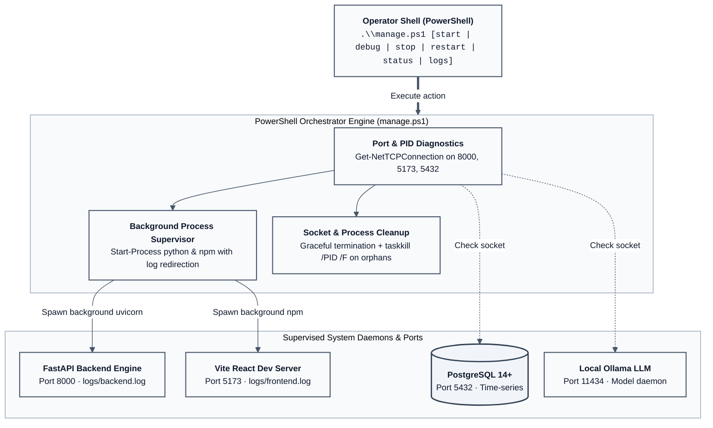
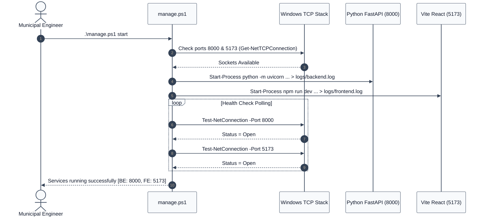

# 08. System Operations & Maintenance Runbook

This runbook provides complete operational procedures for configuring, launching, maintaining, and troubleshooting NIRIKSHA in field and command center environments.

---

## 1. Service Orchestration Architecture (`manage.ps1`)

All platform services (Python FastAPI backend, Vite React frontend, and background log tailers) are orchestrated via the native Windows PowerShell CLI script [manage.ps1](file:///d:/proj/SIH/manage.ps1).





---

## 2. CLI Command Reference

All commands must be executed in PowerShell from the project root (`d:\proj\SIH`):

### 2.1 Starting Services in Background
```powershell
.\manage.ps1 start
```
- Verifies Python and Node.js prerequisites.
- Verifies PostgreSQL port 5432 availability.
- Spawns the FastAPI backend (port 8000) and redirects stdout/stderr to `logs/backend.log`.
- Spawns the Vite frontend (port 5173) and redirects stdout/stderr to `logs/frontend.log`.
- Confirms socket listening status before returning control to the shell.

### 2.2 Interactive Live Debug Stream
```powershell
.\manage.ps1 debug
```
- Launches both backend and frontend concurrently in the active console.
- Color-codes output lines with `[BACKEND]` in cyan and `[FRONTEND]` in magenta.
- Press `Ctrl + C` to terminate both services cleanly.

### 2.3 Checking System Health & Ports
```powershell
.\manage.ps1 status
```
Outputs tabular diagnostic status for all managed ports:
```text
Service         Port     Status     PID      Details
---------------------------------------------------------------
FastAPI Backend 8000     LISTENING  14820    Python Uvicorn
Vite Frontend   5173     LISTENING  21044    Node.js Dev Server
PostgreSQL DB   5432     LISTENING  4912     PostgreSQL 16
MQTT Broker     1883     LISTENING  3180     Mosquitto Service
Ollama LLM      11434    LISTENING  8944     Ollama Inference Daemon
```

### 2.4 Graceful Shutdown
```powershell
.\manage.ps1 stop
```
- Queries active PIDs bound to ports 8000 and 5173.
- Issues graceful SIGTERM signals.
- Verifies socket release within 3 seconds; forces termination if hung.

### 2.5 Real-Time Backend Log Tailing
```powershell
.\manage.ps1 logs
```
Tails `logs/backend.log` using native PowerShell file streaming (`Get-Content -Path logs/backend.log -Wait -Tail 50`).

---

## 3. Network Ports & Topology Map

| Port | Protocol | Service | Direction | Required For |
| :--- | :--- | :--- | :--- | :--- |
| **8000** | HTTP / WS | FastAPI Core Backend | Inbound (Local) | REST API, Swagger docs, `/ws/telemetry` |
| **5173** | HTTP | React + Vite UI | Inbound (Local) | Operator browser dashboard |
| **5432** | TCP | PostgreSQL Database | Internal | Time-series telemetry and alert persistence |
| **1883** | TCP | Mosquitto MQTT Broker | Inbound | Field telemetry ingestion from remote RTUs |
| **11434**| HTTP | Ollama Inference Server | Internal | Offline AI diagnostics and prompt evaluation |

---

## 4. Environment Configuration (`backend/.env`)

All parameters are configured via `backend/.env`. A complete configuration template:

```env
# ==========================================
# POSTGRESQL DATABASE & POOL CONFIGURATION
# ==========================================
DB_HOST=localhost
DB_PORT=5432
DB_USER=postgres
DB_PASSWORD=postgres
DB_NAME=iot_dashboard
DB_MIN_POOL_SIZE=2
DB_MAX_POOL_SIZE=10

# ==========================================
# IN-MEMORY BATCH BUFFER TUNING
# ==========================================
# Maximum milliseconds before queued telemetry is committed to DB
BATCH_FLUSH_INTERVAL_MS=300
# Maximum records buffered before triggering an immediate flush
BATCH_BUFFER_MAX_SIZE=50

# ==========================================
# FASTAPI HTTP & WEBSOCKET SERVER
# ==========================================
SERVER_HOST=127.0.0.1
SERVER_PORT=8000

# ==========================================
# PHYSICAL SERIAL COM PORT GATEWAY
# ==========================================
# Leave empty for automatic COM port auto-discovery
SERIAL_PORT=
SERIAL_BAUD=115200

# ==========================================
# INDUSTRIAL MQTT BROKER INGESTION
# ==========================================
MQTT_ENABLED=true
MQTT_BROKER_HOST=localhost
MQTT_BROKER_PORT=1883
MQTT_TOPIC=niriksha/poles/+/telemetry
MQTT_CLIENT_ID=niriksha_backend_ingestor

# ==========================================
# OFFLINE OLLAMA LLM RUNTIME
# ==========================================
OLLAMA_HOST=http://localhost:11434
OLLAMA_MODEL=qwen2.5:0.5b
```

---

## 5. Troubleshooting & Field Runbook

### 5.1 Serial COM Port Disconnected or Changed
**Symptom**: `logs/backend.log` outputs `Serial communication fault (FileNotFoundError / SerialException)`.
**Remedy**:
1. Inspect physical USB cable from Pole 3 Root Sink.
2. In PowerShell, query active COM devices:
   ```powershell
   [System.IO.Ports.SerialPort]::GetPortNames()
   ```
3. If the OS reassigned the port (e.g. `COM3` changed to `COM5`), the backend's auto-discovery mechanism binds to the new port automatically within 2 seconds. Alternatively, specify `SERIAL_PORT=COM5` in `backend/.env` and run `.\manage.ps1 restart`.

### 5.2 Port 8000 or 5173 Collision (Address Already in Use)
**Symptom**: Backend or frontend fails to start with `WinError 10048` or `EADDRINUSE`.
**Remedy**:
Execute the automated cleanup command or manually kill the orphaned PID:
```powershell
# 1. Automated stop
.\manage.ps1 stop

# 2. Manual identification and kill (if needed)
$conn = Get-NetTCPConnection -LocalPort 8000 -ErrorAction SilentlyContinue
if ($conn) { Stop-Process -Id $conn.OwningProcess -Force }
```

### 5.3 Database Clean & Reset
**Symptom**: Corrupted development rows or schema test records require a clean wipe.
**Remedy**:
Execute the clean script to safely truncate tables while preserving DDL schemas:
```powershell
python backend/clean_db.py
```
To re-initialize tables and verify indexes:
```powershell
python backend/init_postgres.py
```

### 5.4 Microcontroller Firmware Flashing
**Symptom**: Node fails to join mesh or does not transmit telemetry frames.
**Remedy**:
1. Connect ESP32 to programming workstation via USB cable.
2. Open the corresponding sketch from `firmware/`:
   - **Pole 1 (Flood & Voltage):** [pole1_sensor_node.ino](file:///d:/proj/SIH/firmware/pole1_sensor_node/pole1_sensor_node.ino)
   - **Pole 2 (Grid & Power):** [pole2_sensor_node.ino](file:///d:/proj/SIH/firmware/pole2_sensor_node/pole2_sensor_node.ino)
   - **Pole 3 (Root Gateway):** [pole3_gateway_hub.ino](file:///d:/proj/SIH/firmware/pole3_gateway_hub/pole3_gateway_hub.ino)
3. Ensure required libraries (`painlessMesh`, `ArduinoJson`, `PZEM004Tv30`) are installed in Arduino IDE.
4. Verify board is set to `ESP32 Dev Module` and flash at 921600 baud. For detailed pinouts, see [Firmware Documentation](file:///d:/proj/SIH/firmware/README.md).

